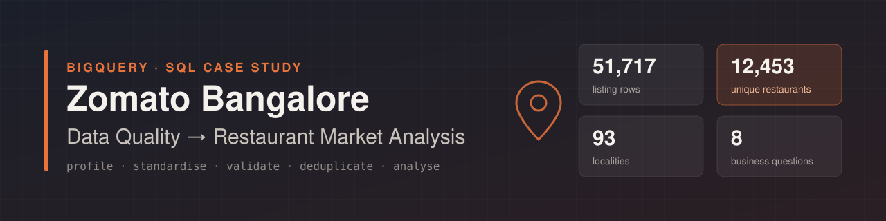
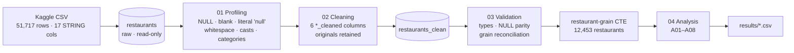

<p align="center">
  
</p>

<p align="center">
  
  
  
  
</p>

# Zomato Bangalore — SQL Data Quality & Restaurant Market Analysis

> Part of [**sql-business-problems**](../../README.md) · Category `06_public_datasets` · Case study 105
> Unlike the other case studies, this one uses a **real public dataset** (Zomato Bangalore, Kaggle) rather than the `sahyadri_b2b` dataset.

An end-to-end SQL project in **Google BigQuery**: profile a raw 51,717-row scrape of Zomato's Bangalore listings, standardise and type-cast it into an auditable clean layer, then answer business questions a food-delivery company would ask about localities, ratings, cuisines and online-ordering adoption.

The project's main finding is about the data itself. **The dataset has 51,717 rows, but only 12,453 restaurants are behind them.** Every metric counted per row inflated restaurant counts by about 4× and distorted ratings, so all analysis queries were rebuilt on a deduplicated restaurant grain.

---

## Contents

- [Key findings](#key-findings)
- [Workflow](#workflow)
- [Repository structure](#repository-structure)
- [Data](#data)
- [Data quality & cleaning](#data-quality--cleaning)
- [Business questions](#business-questions)
- [Selected results](#selected-results)
- [How to reproduce](#how-to-reproduce)
- [Limitations & next steps](#limitations--next-steps)

---

## Key findings

| # | Finding | Evidence |
|---|---|---|
| 1 | **Listings ≠ restaurants.** One restaurant appears in 4.15 listing contexts on average (max 34). The `url` column holds a unique `?context=` query string, so even `COUNT(DISTINCT url)` returns the row count. | [V02](sql/03_validation/02_restaurant_grain_checks.sql) |
| 2 | **Locality rankings change at restaurant grain.** BTM has the most rows (5,124) but only 724 restaurants. **Whitefield is the largest market** with 885 restaurants. | [A01](results/a01_locality_concentration.csv) |
| 3 | **Counting rows inflates ratings.** 11 localities average ≥ 3.8 when counted per listing; **none** do when counted per restaurant. Indiranagar is highest at 3.79, against a city average of 3.63. | [A04](sql/04_analysis/a04_high_rating_low_online_adoption.sql) |
| 4 | **Online-ordering adoption ranges from 44% to 64%** across the 12 localities with 300+ restaurants. HSR leads at 63.9% and Electronic City trails at 44.0%. | [A08](results/a08_cuisine_diversity_and_online_adoption.csv) |
| 5 | **Indiranagar is a delivery opportunity.** It is the best-rated large locality (3.79), yet 48% of its restaurants don't take online orders. | [A04](results/a04_high_rating_low_online_adoption.csv) |
| 6 | **Specialty cuisines get the highest ratings, staple cuisines have the most restaurants.** North Indian is served by 40% of restaurants and is the #1 cuisine in all 12 large localities. European (4.19), Asian (4.07) and BBQ (4.01) have the highest ratings. | [A05](results/a05_top_cuisines_by_presence.csv) · [A06](results/a06_top_rated_cuisines.csv) |

## Workflow



**Working rules:** the raw table is never modified · originals are kept next to cleaned columns · `SAFE_CAST` failures are separated from source NULLs · duplicates are flagged and investigated, never deleted on sight · NULL imputation is deliberately deferred · every step ends with a validation query.

## Repository structure

```
06_public_datasets/01_zomato_bangalore_restaurant_market/
├── sql/
│   ├── 00_source/          # Original BigQuery console scripts, verbatim (audit trail)
│   ├── 01_profiling/       # 13 column-level profiling scripts (00–12)
│   ├── 02_cleaning/        # Cleaning preview + CREATE TABLE restaurants_clean
│   ├── 03_validation/      # Clean-table checks + restaurant-grain reconciliation
│   └── 04_analysis/        # A01–A08 business questions (restaurant grain)
├── results/                # Query outputs captured from BigQuery (CSV)
├── docs/
│   ├── data_dictionary.md          # Raw, cleaned and derived fields
│   ├── data_quality_log.md         # Column tracker, findings, validation results
│   ├── query_review_log.md         # Original attempt vs corrected query, per question
│   └── zomato_data_quality_tracker.xlsx
└── assets/banner.svg
```

## Data

| | |
|---|---|
| **Source** | [Zomato Bangalore Restaurants — Kaggle](https://www.kaggle.com/datasets/himanshupoddar/zomato-bangalore-restaurants) (not redistributed here) |
| **Warehouse** | Google BigQuery (sandbox) — `zomatoanalytics.Zomato_csv` |
| **Raw grain** | One row per listing: restaurant × `listed_in_type` (7) × `listed_in_city` (30) |
| **Analysis grain** | One row per restaurant: `restaurant_id = REGEXP_EXTRACT(url, r'^[^?]+')`, keeping the highest-vote snapshot |

Full field reference: [`docs/data_dictionary.md`](docs/data_dictionary.md)

## Data quality & cleaning

| Column | Issue found | Treatment |
|---|---|---|
| `rate` | `3.9 /5` vs `3.9/5`; 7,775 NULL · 2,208 `NEW` · 69 `-` | `REGEXP_REPLACE(TRIM(rate), r'\s*/\s*', '/')`; numeric rating via `SAFE_CAST(SPLIT(...)[SAFE_OFFSET(0)])` |
| `approx_cost_for_two_people` | `1,800` stored as text; 346 NULL | `SAFE_CAST(REPLACE(TRIM(..), ',', '') AS INT64)` — NULLs preserved, not imputed |
| `votes` | Text type; 0 invalid values | `SAFE_CAST(TRIM(votes) AS INT64)` |
| `address` · `phone` · `menu_item` | Repeated internal whitespace | `REGEXP_REPLACE(TRIM(col), r'\s+', ' ')` |
| `location` vs `listed_in_city` | Same location under up to 21 listing zones | Kept as separate dimensions |
| `rest_type` · `cuisines` | Comma-separated multi-values | Preserved; cuisines exploded with `UNNEST` only at analysis time |
| `url` | Unique per row due to `?context=` | URL path used as the restaurant key |

Validation passed: row count preserved (51,717), no new cast failures (cost NULLs = 346 before and after), rating buckets reconcile to the row count, and the dedup layer has 12,453 restaurants with 0 duplicates.
Details: [`docs/data_quality_log.md`](docs/data_quality_log.md)

## Business questions

| ID | Business question | SQL | Result |
|---|---|---|---|
| A01 | Which localities have the largest restaurant presence, and how are they rated? | [sql](sql/04_analysis/a01_locality_concentration.sql) | [csv](results/a01_locality_concentration.csv) |
| A02 | Which large localities (≥ 500 restaurants) are rated highest? | [sql](sql/04_analysis/a02_investor_high_rated_localities.sql) | [csv](results/a02_investor_high_rated_localities.csv) |
| A03 | Where is online-ordering adoption highest (≥ 300 restaurants)? | [sql](sql/04_analysis/a03_online_ordering_adoption.sql) | [csv](results/a03_online_ordering_adoption.csv) |
| A04 | Where are ratings strong but online adoption low? | [sql](sql/04_analysis/a04_high_rating_low_online_adoption.sql) | [csv](results/a04_high_rating_low_online_adoption.csv) |
| A05 | Which individual cuisines have the widest presence? | [sql](sql/04_analysis/a05_top_cuisines_by_presence.sql) | [csv](results/a05_top_cuisines_by_presence.csv) |
| A06 | Which cuisines (≥ 100 restaurants) are rated highest? | [sql](sql/04_analysis/a06_top_rated_cuisines.sql) | [csv](results/a06_top_rated_cuisines.csv) |
| A07 | Which locality × cuisine pairs are rated highest? | [sql](sql/04_analysis/a07_locality_cuisine_rating_matrix.sql) | [csv](results/a07_locality_cuisine_rating_matrix.csv) |
| A08 | Which localities combine cuisine diversity with online adoption? | [sql](sql/04_analysis/a08_cuisine_diversity_and_online_adoption.sql) | [csv](results/a08_cuisine_diversity_and_online_adoption.csv) |

Each query began as a practice attempt. The originals are kept verbatim in [`sql/00_source`](sql/00_source), and [`docs/query_review_log.md`](docs/query_review_log.md) records what changed in review and why. One example: the original online-adoption percentage divided by `total × 100` and returned 0 for every locality.

## Selected results

**A01 — Locality concentration (top 8): listing count vs restaurant count**

| Location | Restaurants | Listing rows | Rated restaurants | Avg rating |
|---|---:|---:|---:|---:|
| Whitefield | 885 | 2,144 | 630 | 3.6 |
| Electronic City | 730 | 1,258 | 458 | 3.5 |
| BTM | 724 | 5,124 | 534 | 3.6 |
| HSR | 703 | 2,523 | 527 | 3.6 |
| Marathahalli | 683 | 1,846 | 511 | 3.5 |
| JP Nagar | 523 | 2,235 | 374 | 3.6 |
| Indiranagar | 522 | 2,083 | 440 | 3.8 |
| Bannerghatta Road | 474 | 1,630 | 354 | 3.5 |

**A03 — Online-ordering adoption (localities with ≥ 300 restaurants, top 5)**

| Location | Restaurants | Online-order % | Avg rating |
|---|---:|---:|---:|
| HSR | 703 | 63.87 | 3.64 |
| Sarjapur Road | 338 | 61.24 | 3.60 |
| Jayanagar | 365 | 59.18 | 3.76 |
| BTM | 724 | 56.63 | 3.57 |
| Bannerghatta Road | 474 | 53.16 | 3.48 |

**A06 — Highest-rated cuisines (≥ 100 restaurants, top 5)**

| Cuisine | Restaurants | Avg rating |
|---|---:|---:|
| European | 107 | 4.19 |
| Asian | 214 | 4.07 |
| BBQ | 153 | 4.01 |
| American | 218 | 3.96 |
| Finger Food | 179 | 3.94 |

## How to reproduce

1. Download `zomato.csv` from [Kaggle](https://www.kaggle.com/datasets/himanshupoddar/zomato-bangalore-restaurants) and load it into BigQuery as `<project>.<dataset>.restaurants`, with every column typed as `STRING`.
2. Find and replace `zomatoanalytics.Zomato_csv` with your `<project>.<dataset>` in all files under `sql/`.
3. Run the folders in order: `01_profiling` → `02_cleaning/02_create_restaurants_clean.sql` → `03_validation` → `04_analysis`.
4. Compare your outputs with [`results/`](results).

> Tables in the BigQuery sandbox expire after 60 days. Re-run `02_create_restaurants_clean.sql` to rebuild `restaurants_clean`. Each query scans well under 1 GB, within the free monthly tier.

## Limitations & next steps

- **Missing-value treatment is deferred.** Rows with NULL `location` (11 restaurants) are excluded, and cost NULLs are not imputed.
- **Snapshot choice:** when a restaurant's rating differs between listings, the highest-vote snapshot is used. This is a documented assumption; the scrape has no timestamp.
- **A04 threshold:** the spec's 3.8 cut-off returns no localities at restaurant grain, so 3.7 is applied and the reason is documented in the query.
- **Next:** price-band analysis on `approx_cost_cleaned`, splitting `rest_type` into single types, `book_table` vs rating, and a Looker Studio dashboard over the results.

---

The dataset belongs to its original publisher on Kaggle and is not included in this repository.

[← Back to all case studies](../../README.md)
