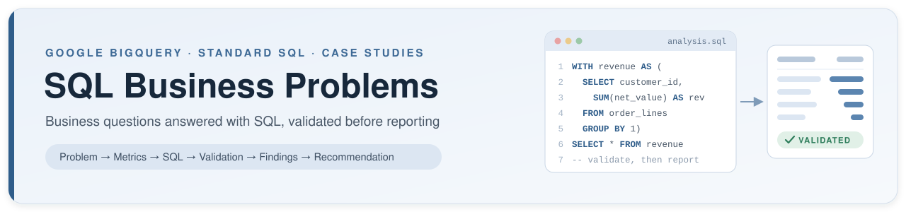

<p align="center">
  
</p>

Business problems analysed and answered with SQL — each case study starts from a business question, not from a query.

> **New here?** The [Getting Started Guide](GUIDE.md) explains how the repository is organised, how to read a case study and how to run the SQL in BigQuery.

<p align="center">
  
  
  
  
</p>

---

## 1. Project overview

This repository documents business problems solved using SQL. Each case study follows the same structure: a clearly stated business problem, the data and metrics used to address it, the SQL solution, the checks used to validate the numbers, and the business interpretation of the results.

The focus is on decision support for commercial and operational teams — customer and revenue risk, sales and profitability, operations and supply chain, and data quality — rather than on isolated SQL exercises.

## 2. Objective

The repository is intended to demonstrate:

- **Analytical thinking** — translating an ambiguous business concern into specific, answerable questions and measurable metrics.
- **SQL proficiency** — structured, readable queries using CTEs, joins, aggregations, window functions and conditional logic.
- **Data validation** — reconciling totals, testing joins for row inflation, and checking assumptions before results are reported.
- **Business decision support** — converting verified results into findings and recommendations that a manager can act on.

## 3. Analytical approach

Every case study follows the same workflow:

| Step | Activity | Output |
|---|---|---|
| 1 | **Define the business problem** | Problem statement and the decision it supports |
| 2 | **Identify relevant data and metrics** | Tables, grain, joins and metric definitions |
| 3 | **Analyse the data using SQL** | Documented, reproducible queries |
| 4 | **Validate calculations and assumptions** | Reconciliation checks, row counts, null and duplicate tests |
| 5 | **Interpret findings** | Results stated with their context and limits |
| 6 | **Develop evidence-based recommendations** | Actions tied directly to verified findings |

## 4. Repository structure

| Category | Focus |
|---|---|
| [`01_customer_and_revenue`](01_customer_and_revenue/) | Customer value, revenue concentration, churn and revenue-at-risk |
| [`02_sales_and_profitability`](02_sales_and_profitability/) | Product, category and salesperson performance; discounts and margin |
| [`03_operations_and_supply_chain`](03_operations_and_supply_chain/) | Order fulfilment, delivery performance, shipping cost and returns |
| [`04_data_quality_and_reconciliation`](04_data_quality_and_reconciliation/) | Referential integrity, duplicates, standardisation and order-to-cash reconciliation |
| [`05_advanced_analytics`](05_advanced_analytics/) | Cohorts, segmentation, time-series patterns and other multi-step analyses |
| [`datasets_and_documentation`](datasets_and_documentation/) | Dataset schema and shared metric definitions |

```
sql-business-problems/
├── README.md
├── GUIDE.md
├── CHANGELOG.md
├── 01_customer_and_revenue/
│   ├── 01_customer_revenue_risk/
│   ├── 02_customer_churn_early_warning/
│   └── 03_revenue_growth_bridge/
├── 02_sales_and_profitability/
│   ├── 01_discount_margin_erosion/
│   ├── 02_salesperson_scorecard/
│   └── 03_price_volume_mix/
├── 03_operations_and_supply_chain/
│   ├── 01_late_delivery_root_cause/
│   ├── 02_freight_cost_to_serve/
│   ├── 03_open_order_backlog_review/
│   └── 04_dispatch_workload_planning/
├── 04_data_quality_and_reconciliation/
│   ├── 01_order_to_cash_reconciliation/
│   ├── 02_data_quality_scorecard/
│   └── 03_customer_master_deduplication/
├── 05_advanced_analytics/
│   ├── 01_abc_xyz_product_classification/
│   ├── 02_customer_payment_behaviour/
│   └── 03_rfm_customer_segmentation/
├── datasets_and_documentation/
│   ├── schema.md
│   └── metric_definitions.md
└── images/
```

## 5. Technical stack

- **Google BigQuery** — Standard SQL

Additional tools will be listed here only when they are used in a published case study.

## 6. Case studies

| # | Case study | Category | Status |
|---|---|---|---|
| 1 | [Customer revenue risk](01_customer_and_revenue/01_customer_revenue_risk/) | Customer and revenue | Version 1 query added · findings pending revision |
| 2 | [Order-to-cash reconciliation](04_data_quality_and_reconciliation/01_order_to_cash_reconciliation/) | Data quality and reconciliation | Complete |
| 3 | [Late delivery root cause](03_operations_and_supply_chain/01_late_delivery_root_cause/) | Operations and supply chain | Complete |
| 4 | [Customer churn early warning](01_customer_and_revenue/02_customer_churn_early_warning/) | Customer and revenue | Complete |
| 5 | [Discount and margin erosion](02_sales_and_profitability/01_discount_margin_erosion/) | Sales and profitability | Complete |
| 6 | [Freight cost-to-serve and minimum order value](03_operations_and_supply_chain/02_freight_cost_to_serve/) | Operations and supply chain | Complete |
| 7 | [Data quality scorecard](04_data_quality_and_reconciliation/02_data_quality_scorecard/) | Data quality and reconciliation | Complete |
| 8 | [ABC-XYZ product classification](05_advanced_analytics/01_abc_xyz_product_classification/) | Advanced analytics | Complete |
| 9 | [Revenue growth bridge](01_customer_and_revenue/03_revenue_growth_bridge/) | Customer and revenue | Complete |
| 10 | [Salesperson performance scorecard](02_sales_and_profitability/02_salesperson_scorecard/) | Sales and profitability | Complete |
| 11 | [Customer payment behaviour and credit terms](05_advanced_analytics/02_customer_payment_behaviour/) | Advanced analytics | Complete |
| 12 | [Open order backlog review](03_operations_and_supply_chain/03_open_order_backlog_review/) | Operations and supply chain | Complete |
| 13 | [Customer master de-duplication](04_data_quality_and_reconciliation/03_customer_master_deduplication/) | Data quality and reconciliation | Complete |
| 14 | [Price-volume-mix analysis](02_sales_and_profitability/03_price_volume_mix/) | Sales and profitability | Complete |
| 15 | [Dispatch workload and capacity planning](03_operations_and_supply_chain/04_dispatch_workload_planning/) | Operations and supply chain | Complete |
| 16 | [RFM customer segmentation](05_advanced_analytics/03_rfm_customer_segmentation/) | Advanced analytics | Complete |

Case studies are listed as complete only once their SQL, validation and findings have been added to the repository. A dated record of every addition and change is kept in [`CHANGELOG.md`](CHANGELOG.md).

## 7. Data and methodology

Case studies initially use the **`sahyadri_b2b`** dataset — transactional data for a B2B industrial products distributor covering customers, products, sales orders, order line items, payments, shipments and employees. The table structure, keys and known data characteristics are documented in [`datasets_and_documentation/schema.md`](datasets_and_documentation/schema.md).

For each analysis, the following are documented alongside the SQL:

- **Assumptions** — how statuses, nulls, partial payments and edge cases are treated.
- **Metric definitions** — the exact formula and grain of every reported metric, referencing [`metric_definitions.md`](datasets_and_documentation/metric_definitions.md).
- **Validation methods** — the checks used to confirm that totals reconcile and joins do not duplicate or drop records.

## 8. Limitations

- Results depend on the completeness and accuracy of the underlying data. Known data quality issues are documented and their treatment is stated in each analysis.
- Findings describe the dataset analysed; they are not generalised beyond it.
- Recommendations are grounded only in verified findings. Where the data cannot support a conclusion, that is stated rather than inferred.

---

**Author:** Tanmay Mandal — Business Analysis, Operations & ERP
