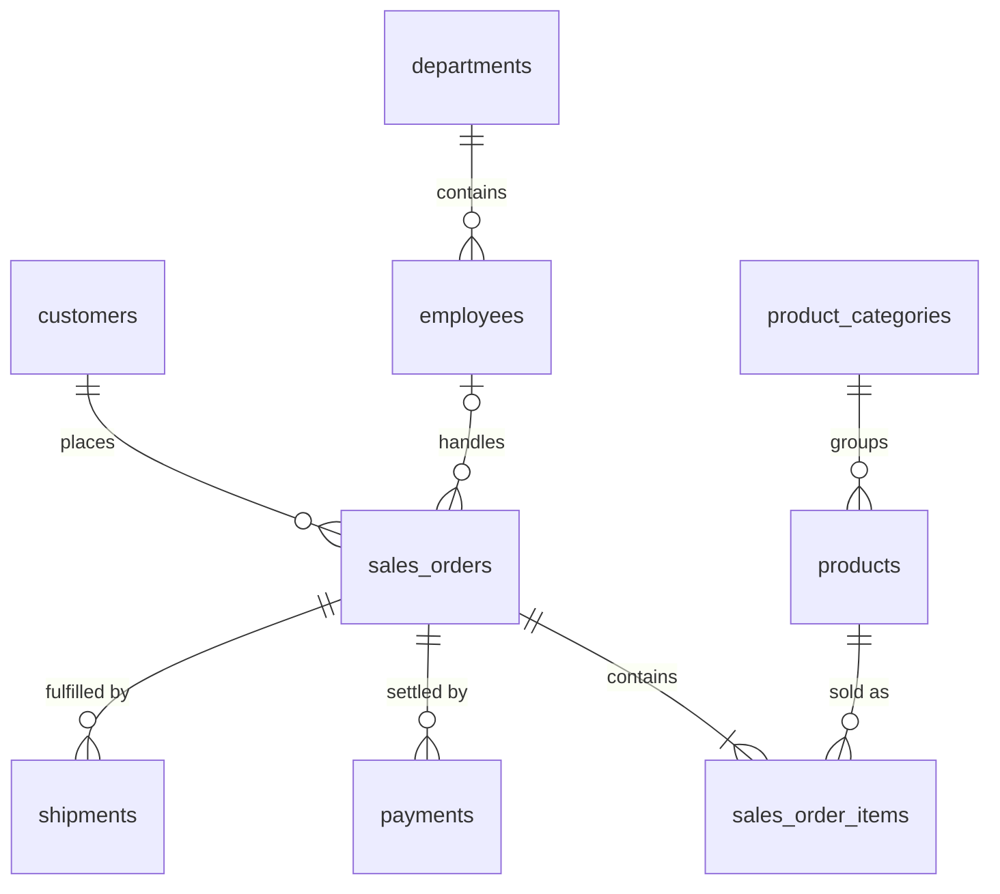

# Dataset Schema · `sahyadri_b2b`

Transactional data for a fictional B2B industrial products distributor (bearings, pneumatic and hydraulic components, motors, pumps, valves and related products) selling to business customers across India.

- **Platform:** Google BigQuery — referenced as `<project_id>.sahyadri_b2b.<table>`
- **Transaction period:** orders dated 2024-01-01 to 2026-09-30
- **Source:** CSV export of the dataset; row counts and profiling notes below were taken from that export and should be re-confirmed in BigQuery before use in a case study.

---

## Entity relationships

| Relationship | Cardinality | Note |
|---|---|---|
| `customers` → `sales_orders` | 1 : many | 431 of 500 customers have at least one order |
| `employees` → `sales_orders` | 1 : many | `employee_id` is null on 352 orders |
| `sales_orders` → `sales_order_items` | 1 : many | Every order has at least one line item |
| `sales_orders` → `payments` | 1 : 0..many | An order can have up to 3 payments; 1,501 orders have none |
| `sales_orders` → `shipments` | 1 : 0..many | An order can have up to 2 shipments; 583 orders have none |
| `products` → `sales_order_items` | 1 : many | |
| `product_categories` → `products` | 1 : many | |
| `departments` → `employees` | 1 : many | |

> **Join risk:** `payments` and `shipments` are both one-to-many from `sales_orders`. Joining both to orders (or to line items) in the same query multiplies rows. Aggregate each to order level before joining.

---

## Tables

Types shown are the intended BigQuery types.

### `customers` — 500 rows · grain: one row per customer

| Column | Type | Key | Notes |
|---|---|---|---|
| `customer_id` | INT64 | PK | 1001–1500 |
| `customer_name` | STRING | | |
| `city` | STRING | | 5 nulls |
| `state` | STRING | | 22 states |
| `customer_segment` | STRING | | Distributor, Enterprise, Mid-Market, SMB |
| `industry` | STRING | | 14 values; 18 nulls |
| `registration_date` | DATE | | 6 nulls |

### `products` — 200 rows · grain: one row per product

| Column | Type | Key | Notes |
|---|---|---|---|
| `product_id` | INT64 | PK | 2001–2200 |
| `product_name` | STRING | | |
| `category_id` | INT64 | FK → `product_categories` | |
| `unit_cost` | NUMERIC | | 4 nulls |
| `selling_price` | NUMERIC | | List price; actual transaction price is on `sales_order_items` |

### `product_categories` — 10 rows · grain: one row per category

| Column | Type | Key | Notes |
|---|---|---|---|
| `category_id` | INT64 | PK | |
| `category_name` | STRING | | e.g. Bearings, Pneumatic Components, Pumps |

### `sales_orders` — 10,000 rows · grain: one row per order (header)

| Column | Type | Key | Notes |
|---|---|---|---|
| `order_id` | INT64 | PK | 100001–110000 |
| `customer_id` | INT64 | FK → `customers` | |
| `employee_id` | INT64 | FK → `employees` | 352 nulls (unassigned salesperson) |
| `order_date` | DATE | | 2024-01-01 to 2026-09-30 |
| `promised_delivery_date` | DATE | | 166 nulls |
| `order_status` | STRING | | Cancelled, Delivered, Pending, Processing, Returned, Shipped |
| `payment_status` | STRING | | Paid, Partially Paid, Unpaid |

### `sales_order_items` — 28,201 rows · grain: one row per product per order

| Column | Type | Key | Notes |
|---|---|---|---|
| `order_item_id` | INT64 | PK | |
| `order_id` | INT64 | FK → `sales_orders` | |
| `product_id` | INT64 | FK → `products` | No order contains the same product twice |
| `quantity` | INT64 | | All values > 0 |
| `unit_price` | NUMERIC | | Transaction price before discount |
| `discount_percent` | NUMERIC | | 0–18; 336 nulls |

### `payments` — 10,568 rows · grain: one row per payment receipt

| Column | Type | Key | Notes |
|---|---|---|---|
| `payment_id` | INT64 | PK | |
| `order_id` | INT64 | FK → `sales_orders` | |
| `payment_date` | DATE | | |
| `amount` | NUMERIC | | All values > 0 |
| `payment_method` | STRING | | Cheque, Demand Draft, NEFT, RTGS, UPI; 190 nulls |

### `shipments` — 10,031 rows · grain: one row per shipment

| Column | Type | Key | Notes |
|---|---|---|---|
| `shipment_id` | INT64 | PK | |
| `order_id` | INT64 | FK → `sales_orders` | |
| `shipment_date` | DATE | | |
| `delivery_date` | DATE | | 65 nulls |
| `shipping_city` | STRING | | Inconsistent casing and spacing — see profiling notes |
| `shipment_status` | STRING | | Delivered, In Transit, Returned |
| `shipping_cost` | NUMERIC | | 316 nulls |

### `employees` — 50 rows · grain: one row per employee

| Column | Type | Key | Notes |
|---|---|---|---|
| `employee_id` | INT64 | PK | 101–150 |
| `employee_name` | STRING | | |
| `department_id` | INT64 | FK → `departments` | |
| `designation` | STRING | | |
| `hire_date` | DATE | | |
| `salary` | NUMERIC | | 2 nulls |

### `departments` — 8 rows · grain: one row per department

| Column | Type | Key | Notes |
|---|---|---|---|
| `department_id` | INT64 | PK | |
| `department_name` | STRING | | |

---

## Profiling notes

Observed in the CSV export. Each case study states how any relevant item is treated.

**Integrity checks that passed**

- All primary keys are unique and non-null.
- No orphan foreign keys: every non-null `customer_id`, `employee_id`, `product_id`, `category_id`, `department_id` and `order_id` reference resolves to its parent table.
- No payment is dated before its order; no delivery is dated before its shipment; no customer registered after their first order.

**Items requiring treatment**

| Area | Observation | Typical treatment |
|---|---|---|
| Nulls | `discount_percent` (336), `shipping_cost` (316), `payment_method` (190), `promised_delivery_date` (166), `delivery_date` (65), `sales_orders.employee_id` (352), plus minor nulls in `customers`, `products.unit_cost`, `employees.salary` | Define per metric; never silently coerce to zero without stating it |
| Text standardisation | `shipping_city` has 79 raw values but 61 after trimming and case-folding; 30 values carry leading/trailing spaces | `INITCAP(TRIM(...))` or a city mapping table |
| Possible duplicate customers | 500 customer names reduce to 498 after case and whitespace normalisation | Review pairs before any customer-level aggregation |
| Duplicate transactions | 24 orders match another order on every header column, but no matching pair has identical line items, so they are separate orders. 7 payments repeat an earlier receipt for the same order, date and amount (one with the payment method missing) and are true duplicates — see [order-to-cash reconciliation](../04_data_quality_and_reconciliation/01_order_to_cash_reconciliation/) | Treat orders as distinct; exclude or reverse duplicate receipts |
| Missing discounts | Every Paid order that contains a NULL-discount line was paid exactly at the 0 % value (260 orders) | Treat NULL `discount_percent` as 0 % |
| Pricing | 2 products have `selling_price` below `unit_cost` | Flag in margin analysis |
| Status consistency | `order_status` and `payment_status` are independent fields (e.g. cancelled orders with partial payment exist) | Reconcile `payment_status` against `payments` where relevant |
